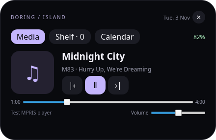

# Boring Island for KDE Plasma

**English** | [Polski](README.pl.md)

A native Linux plasmoid inspired by the `dev` branch of
[boring.notch](https://github.com/TheBoredTeam/boring.notch/tree/dev).
Version **0.3.4** requires **Plasma 6.6+**. This is an unofficial reimplementation,
not a complete port of every macOS feature.



## Installation

Download the `.plasmoid` package from [Releases](https://github.com/piotrek1488/boring-island-plasma/releases)
and install it through Plasma's **Add Widgets → Get New Widgets → Install Widget
From Local File**. Add **Boring Island** to your desktop or a top panel.

Alternatively, from a source checkout:

```bash
./scripts/install.sh
```

Plasma saves the widget and its settings and restores them at login. No separate
service or autostart entry is needed.

An optional helper creates a small, centered top panel:

```bash
./scripts/add-top-panel.sh
```

It preserves existing panels and avoids adding a second copy if a panel already
contains Boring Island. The helper has not been tested on the user's live desktop.
If you already have a top panel, add the widget there manually to avoid overlap.

## Language and appearance

Right-click the widget and open its settings, then select **Boring Island**.

- **Language:** English by default, or Polski. The selection is saved for each
  widget separately and does not follow the system language. Labels, hints,
  accessibility descriptions and dates update when the setting is applied.
- **Notch:** outward-curving top shoulders and rounded bottom corners.
- **Dynamic Island:** a rounded capsule; the default shape.
- **Fit height to panel:** enabled by default; follows the panel window height.
- Edit **Compact height (px)** from 16 to 128 to disable automatic fitting. The
  shape uses the requested height multiplied by compact scale. Text, indicator and padding
  scale with the height; compact width remains independently configurable.
- A smaller notch stays aligned to the top edge of the panel window; a smaller island
  is centered vertically. On the desktop, automatic height is 42 px.
- Sizes use Qt logical pixels, so desktop display scaling still applies. The notch bypasses internal applet padding/clipping; the expanded content has separate width, height and 60–200% scale controls.
- Configure hover delay, battery visibility and reduced motion.

Device names, filenames, track metadata and event content remain in their original
language. External KDE dialogs and service error details use their own language
settings. The configuration category uses the language-neutral name Boring Island.

For an island effect, enable a floating panel in Plasma settings. For a notch,
disable floating and place the panel at the top edge. Plasma's theme still controls
the panel background and margins. The expanded view uses a single animated surface containing the compact header and
content. In a panel, a frameless Plasma dialog overlays the compact widget at its
screen position, with no themed popup gap. The desktop view uses the same surface.
It does not create an independent overlay above every window or a physical cutout.

## Features

- MPRIS media controls: previous/next track, play/pause, cover art, title, artist,
  position, seeking and **player** volume.
- KDE's automatic player selection, with controls respecting player capabilities.
- An idle clock and a date in the expanded view.
- A daily agenda from KDE/Akonadi calendars: timed and all-day events, calendar
  colors, previous/next day navigation and refresh.
- File sharing from the shelf through KDE Connect: click ↗, choose a paired and
  reachable device, then click **Send**. Dropping a file never sends it automatically.
- Battery icon with charge level and actual KDE charge state: charging, discharging,
  fully charged or plugged in without charging. Hidden without an internal battery.
  Percentage can appear inside, left/right of the icon, or be hidden. The old `+`
  power indicator has been replaced by a bolt to the left, only while charging.
  At 20% or less the icon turns red; an unplugged battery shows a temporary low
  battery message once per discharge episode, using the notification preview duration.
- A persistent shelf of up to 24 local file/folder shortcuts: drop, open, drag out
  or remove a shortcut with ×. Removing a shortcut never deletes the original.
- Independent settings and shelf contents for each widget instance.

The shelf stores addresses only. Moving or deleting the original breaks its
shortcut. MPRIS support and available controls depend on the player. An empty media
view means no active MPRIS source. Player volume does not change system volume.
Cover art may be fetched from URLs supplied by the player.

## Notifications and activity

- **Notifications:** a preview appears inside the notch/island for **4 seconds** by
  default (configurable from 1 to 60 seconds). Bursts are queued, with at most 20
  pending previews. Expiry hides only the preview, leaving KDE's history intact.
- Hover or click to expand, then choose **Notifications**. Delete one entry with
  **×**, or use **Clear all**. This uses Plasma's shared notification model:
  deleting here removes it from KDE's notification center, and vice versa.
  Existing history is not replayed when the widget loads. Live arrivals use a
  separate native model so history filters and early expiry do not drop previews. Do Not Disturb and
  application popup/history preferences are respected. Transient notifications
  still follow KDE's retention rules; the widget does not keep a private archive.
- **Automatic priority:** temporary notification → package operation → playing
  media → loaded local AI model → clock. Pin Clock, Media, System, Packages, Local AI or Notifications in settings or on the **Activity** tab. A temporary notification takes
  precedence over a pin, then restores it. Pins persist per widget instance.
- **System:** CPU/RAM and available GPU utilization. AMD-compatible sysfs counters
  and optional `nvidia-smi`/`intel_gpu_top` are supported; unsupported GPUs are omitted. Click ↗
  to launch Plasma System Monitor, or `top` in Konsole as a fallback.
- **Packages:** detects command-line operations from APT/dpkg, pacman, DNF/Yum,
  Zypper, Flatpak, pip and npm. The moving bar means activity, not a measured
  percentage. Disappearing processes are not reported as successful installs.
  Processes hidden by system permissions cannot be detected. Discover/PackageKit
  operations are not guaranteed to be detected. Focusing the terminal requires
  optional `kdotool`; Wayland focus policy can still prevent activation.
- **Local AI:** optional, disabled by default. Reads loaded models and context from
  LM Studio (localhost:1234, REST v1 with v0 fallback) or Ollama (localhost:11434).
  Shows inference-process CPU/RSS when readable, and Ollama's reported model memory.
  Generation state and tok/s are shown only when an LM Studio inference process
  exposes an accessible local llama-server `/slots` endpoint with decoded-token
  counters. An unavailable measurement stays unknown. Authenticated/custom-port
  APIs and Ollama's live generation rate are not supported.
- **Media:** retains MPRIS controls, adds a button to raise the player when supported
  and an optional audio output label via `pactl`. The pulsing indicator is decorative.
- **Size:** retain Notch/Dynamic Island, panel height fitting and manual compact
  height. Compact width now supports 80–1000 logical pixels, optionally used as an
  automatic-width limit. Expanded width, height and content scale are independent.
  **Compact scale (%)** (50–200%) also adjusts the collapsed height, width and text;
  the shape bypasses the smaller applet allocation. Editing manual height disables auto-fit.
  Reduced motion disables the expansion and pulse animations.

The optional activity provider requires **Python 3** and Plasma's
`org.kde.plasma.plasma5support` executable data engine. It is started by the widget
for each snapshot (~every 3 seconds), without a service or autostart entry. Disable
individual monitors to stop querying their data; local AI never receives prompts
from the widget. Notifications require the native `org.kde.notificationmanager`
module and the **plasmashell process**. A separate `plasmawindowed` process cannot
share in-memory notification history with the desktop. System notification popups
remain governed by KDE; this version does not globally disable them.

### Build and update

From your local clone:

```bash
git pull --ff-only origin main
python3 scripts/package.py
kpackagetool6 --type Plasma/Applet --upgrade build/boring-island-0.3.4.plasmoid
systemctl --user restart plasma-plasmashell.service
```

For a first installation use `--install` instead of `--upgrade`. The restart
reloads the desktop/panels without logging out; running applications stay open.
Alternatively, `./scripts/install.sh` chooses install or upgrade from source.
Settings and shelf shortcuts are retained. Live Wayland positioning and shared
notification deletion still need testing on a Plasma 6.6+ desktop; see
[verification status](docs/TESTING.md).

## KDE Connect and calendars

**KDE Connect:** install it on the computer and receiving device, connect both to
the same network and pair them. Enable the sharing plugin. Click ↗ beside a shelf
file and **Send** beside a device. The ⚙ button opens pairing settings.

Only paired, reachable devices appear. Devices without the sharing capability have
a disabled button. The widget acknowledges handing the request to KDE Connect;
this does **not** confirm delivery. KDE Connect notifications report progress and
final errors. Archive a folder before sending it; this integration sends files.

**Calendars:** install Plasma's **Calendar Events** (`pimevents`) plugin and configure
calendars in Akonadi/KOrganizer. Ubuntu provides the plugin in `kdepim-addons`; it
is not bundled in the plasmoid package. In the Plasma clock settings, enable the
calendar events plugin and select your calendars. Reload the widget after installing
the plugin.

The widget shares the calendar selection within the Plasma process. It does not
copy events or store account passwords. `plasmawindowed` has separate application
configuration, so it may not see the calendar selection used by `plasmashell`.
The intended host is the Plasma panel or desktop. A missing plugin produces setup
instructions rather than a misleading empty agenda. Create or edit events in
KOrganizer; the widget's agenda is read-only.

## Scope and limitations

Not implemented: AirDrop, camera preview, lyrics, clipboard history, measured audio visualization, system OSD replacement and
fullscreen detection. See the [source analysis, in Polish](docs/ANALIZA.md).

The MPRIS, battery, dialog and notification integrations use **private Plasma APIs**.
Earlier releases were verified on Plasma 6.6.6 / Qt 6.10.2 on Ubuntu 26.04.
The 0.3.1 core tests run on Qt 6.4.2 without a Plasma session. Plasma 5 and older Plasma 6
versions are not supported. Future API changes may require updates.

## Development and testing

```bash
./scripts/test.sh
python3 ./scripts/package.py  # creates build/boring-island-0.3.4.plasmoid
plasmawindowed ./package
```

The standard suites require Qt Quick Test (`qmltestrunner`), `dbus-run-session`,
`python3-dbus`, `python3-gi` and the KDE Connect QML module. Set `QMLTESTRUNNER` if
your distribution installs the runner elsewhere. No translation compilation step
is required: the English/Polish catalog ships inside the package.

The core activity, queue and expansion suites can also run without Plasma:

```bash
./scripts/test-core.sh
```

The shared notification integration test requires Plasma 6.6+ modules and `gdbus`:

```bash
./scripts/test-notifications.sh
```

It uses its own private D-Bus session; do not run the QML fixture on your desktop bus.

The optional native calendar provider test requires CMake, a C++ compiler, Qt 6
Core development files and `libkf6declarative-dev` headers:

```bash
./scripts/test-calendar-plugin.sh
```

It builds a local test plugin and checks asynchronous events and month/year
boundaries. Never install the test plugin into the system plugin directory.

Tests use isolated D-Bus fixtures and synthetic calendar events. They do not send
files to a real phone or access private calendars. Real-device transfer, Akonadi
account synchronization, interactive Wayland panel behavior, physical battery
status, inter-application drag-and-drop, multi-monitor placement and login
restoration still need target-device testing. Screenshots use test data.
See [verification details](docs/TESTING.md).

## Uninstall

Remove the widget from the panel or desktop, then run:

```bash
kpackagetool6 --type Plasma/Applet --remove org.kde.plasma.boringisland
```

Licensed under GPL-3.0-only. See [NOTICE.md](NOTICE.md) for attribution.

## Automated releases

[GitHub Actions](.github/workflows/release.yml) runs core tests and validates the
package on pull requests. Every push/merge to `main` then publishes a GitHub release
with the `.plasmoid` and `SHA256SUMS`; it can also be run manually on `main`.
The workflow uses actions/checkout **7.0.1** and actions/setup-python **7.1.0**
(the latest stable releases checked on 2026-11-05), and the GitHub CLI to publish.
Only the publication job has `contents: write`; no extra secret is required.

The first release uses the metadata version if it is newer than existing tags.
Subsequent merges increment the latest patch version automatically; raising the
metadata version selects a new minor/major release. The built package embeds that
version without a bot commit to the source. A rerun reuses an existing tag on the
same commit and leaves an already published release unchanged. Jobs are serialized
to avoid version collisions. Native Plasma/Wayland checks still need a desktop;
passing the core CI suite does not certify those integrations.

### Overlay interaction (0.3.2)

Hover and notification previews do not request keyboard focus or deactivate the
current application. Mouse buttons inside the widget remain usable. Opening with
a keyboard shortcut/Enter/Space explicitly enables focus for keyboard navigation.
The overlay has no automatic Plasma visual parent: its position is set before
the first expansion frame, and its compact origin/size are held during expansion.
The compact shape follows manual height multiplied by compact scale. Since 0.3.4,
it renders directly in the panel content item, bypassing applet padding and clipping.
The panel window remains the physical drawing boundary; increase the panel height
if the requested shape is taller than that window. A non-floating top panel is
required to reach the physical screen edge. Fixed-size header text layers cross-fade instead of resizing each frame.

`./scripts/test-popup.sh` adds native Plasma tests for nonactivating hover, stable
show/resize position and explicit keyboard focus. It needs Plasma 6 modules;
real compositor animation and focus should also be checked on Wayland.

### Battery, settings and animation speed (0.3.4)

The header's **gear button**, to the right of the battery, opens this widget
instance's native Plasma settings, only in the expanded header. It remains available there when battery display is
disabled or the computer has no internal battery. It follows the availability of
Plasma's configure action; clicking it does not toggle the expansion.

In settings, **Battery percentage** selects Inside the icon / Left of the icon /
Right of the icon (default) / Hidden. Only actual charging shows a bolt, positioned
to the left of the battery. Full and plugged-in states have no badge; hover for the
localized status and exact percentage. These use the existing private KDE battery
model, with no extra polling or service.

**Animation duration (ms)** controls opening and automatic width changes,
from 50 to 1000 ms. The new default is **280 ms** (previously 420 ms). Lower values
are faster; this changes duration, not display refresh rate. Hover delay remains
independent. After the pointer leaves, a manually opened view waits 30 ms for
header/body hover handoff and closes in 60 ms, regardless of opening duration.
Reduce motion overrides both durations with no animation.
