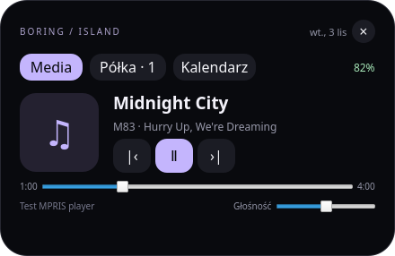

# Boring Island — plasmoid dla KDE Plasma

[English](README.md) | **Polski**

Natywna implementacja dla Linuksa inspirowana gałęzią `dev` projektu
[boring.notch](https://github.com/TheBoredTeam/boring.notch/tree/dev).
Wersja 0.3.10; wymagana **Plasma 6.6+**. Nie jest to pełny port wszystkich funkcji macOS.



## Instalacja

W katalogu tego projektu uruchom:

```bash
./scripts/install.sh
```

Albo zainstaluj gotowy `boring-island-0.3.10.plasmoid` przez „Dodaj elementy interfejsu” →
„Pobierz nowe elementy interfejsu” → „Zainstaluj z pliku lokalnego”.
Dodaj **Boring Island** do pulpitu lub górnego panelu.
Plasma zapisuje widżet i jego konfigurację: po kolejnym logowaniu przywraca go sama.
Nie potrzeba osobnej usługi ani autostartu.

Opcjonalnie, po instalacji:

```bash
./scripts/add-top-panel.sh
```

Ten skrypt tworzy mały, wyśrodkowany panel na górze ekranu; nie usuwa istniejących
paneli i nie dodaje drugiej kopii, jeśli znajdzie widżet w panelu. Skrypt jest
opcjonalnym narzędziem wdrożeniowym; nie był wykonywany na rzeczywistym pulpicie
użytkownika podczas przygotowania pakietu. Na komputerze z istniejącym górnym
panelem lepiej dodać widżet do niego ręcznie, aby uniknąć nakładania paneli.

PPM → ustawienia Boring Island → **Boring Island**:

- **Language / Język** — domyślnie English, opcjonalnie Polski. Wybór jest zapisywany
  osobno dla każdego widżetu i działa niezależnie od języka systemu.
- **Notch** — górne narożniki wygięte na zewnątrz i zaokrąglony dół.
- **Dynamic Island** — zaokrąglona kapsuła; ustawienie domyślne.
- **Dopasuj wysokość do panelu** — domyślnie włączone; widżet korzysta z wysokości
  okna panelu.
- Zmień **Wysokość zwiniętego widżetu (px)**, aby wyłączyć dopasowanie automatyczne. Wartość jest
  w zakresie 16–128. Kształt ma podaną wysokość pomnożoną przez skalę zwinięcia.
  Tekst, wskaźnik i odstępy skalują się razem z wysokością; szerokość ustawisz osobno.
- Mniejszy notch przylega do górnej krawędzi okna panelu, a wyspa jest wyśrodkowana
  w pionie. Na pulpicie automatyczna wysokość wynosi 42 px.
- Wymiary są podane w pikselach logicznych Qt — nadal obowiązuje skalowanie ekranu.
  Notch omija wewnętrzne odstępy i przycinanie obszaru plasmoidu. Rozwinięty widok ma osobną szerokość, wysokość i skalę 60–200%.
- Opóźnienie najechania, pokazywanie baterii i ograniczenie animacji.

Nazwy urządzeń, plików, utworów i treść wydarzeń pozostają w oryginalnym języku.
Zewnętrzne okna KDE i szczegóły błędów usług używają własnych ustawień języka.

Dla efektu wyspy włącz pływający panel w ustawieniach Plasma. Dla notch wyłącz
pływanie i ustaw górną krawędź. Motyw Plasma nadal decyduje o tle i marginesach
samego panelu. Plasmoid nie zastępuje całego panelu ani nie tworzy niezależnej
warstwy ponad wszystkimi oknami. W panelu otwiera się okno Plasma bez ramki, nakładane na pozycję widżetu.
Nagłówek i treść tworzą jeden animowany kształt bez odstępu motywu.
Na pulpicie używany jest ten sam komponent. Nie emuluje fizycznego wycięcia ekranu.

## Powiadomienia, aktywność i aktualizacja

- **Podgląd powiadomień:** domyślnie 4 sekundy, do zmiany w ustawieniach (1–60 s).
  Podglądy tworzą kolejkę do 20 oczekujących wpisów. Upływ czasu chowa podgląd,
  pozostawiając wpis w historii KDE. Po najechaniu wybierz zakładkę **Powiadomienia**.
- **Usuwanie:** × usuwa wpis, „Usuń wszystkie” czyści listę. Widżet i centrum
  powiadomień korzystają ze wspólnego modelu Plasma, więc usunięcie działa w obie
  strony. Stara historia nie jest ponownie wyświetlana po uruchomieniu widżetu.
  Respektowane są tryb Nie przeszkadzać i ustawienia aplikacji. Powiadomienia
  tymczasowe podlegają regułom przechowywania KDE; nie tworzymy osobnego archiwum.
- **Priorytety:** podgląd powiadomienia → operacja na pakietach → odtwarzana muzyka
  → lokalny model AI → zegar. W ustawieniach lub zakładce **Aktywność** można
  przypiąć konkretny widok, w tym **Powiadomienia**. Podgląd chwilowo przerywa przypięcie, po czym je przywraca.
- **System:** CPU, RAM i obsługiwane GPU (liczniki sysfs, opcjonalnie `nvidia-smi`/`intel_gpu_top`).
  Nieobsługiwane GPU są pomijane. ↗ otwiera Monitor systemu lub `top` w Konsole.
- **Pakiety:** wykrywanie poleceń APT/dpkg, pacman, DNF/Yum, Zypper, Flatpak, pip
  i npm. Pasek sygnalizuje aktywność bez rzeczywistego procentu. Zniknięcie procesu
  nie oznacza potwierdzonej udanej instalacji. Ukrytych procesów nie da się wykryć;
  operacje Discover/PackageKit nie są gwarantowane. Pokazanie terminala wymaga
  opcjonalnego `kdotool` i zgody mechanizmu aktywacji okien Wayland.
- **Lokalne AI:** opcjonalnie, domyślnie wyłączone. LM Studio na porcie 1234
  (REST v1 lub v0) i Ollama na 11434: model, kontekst, dostępne dane pamięci i CPU.
  Stan generowania i tok/s są dostępne tylko, gdy proces inferencji LM Studio
  udostępnia lokalne `/slots` z licznikami wygenerowanych tokenów.
  Nieznane wartości nie są zgadywane. Uwierzytelnione API, inne porty serwera
  i pomiar tok/s Ollamy nie są obsługiwane.
- **Multimedia:** przycisk pokazania odtwarzacza, jeśli obsługuje to MPRIS,
  i nazwa wyjścia audio przez opcjonalne `pactl`. Pulsujący wskaźnik jest dekoracyjny.
- **Rozmiar:** wybór Notch/Dynamic Island, automatyczna lub ręczna wysokość,
  szerokość 80–1000 px, automatyczna szerokość z limitem oraz osobne wymiary
  i skala rozwinięcia. **Skala zwiniętego widżetu (%)** (50–200%) zmienia też
  wysokość, szerokość i tekst zwinięcia niezależnie od mniejszego obszaru przydzielonego plasmoidowi. Opcja ograniczenia animacji wyłącza animację rozwijania.

Monitoring wymaga **Python 3** i modułu Plasma `org.kde.plasma.plasma5support`.
Krótki proces zbiera dane co około 3 sekundy, bez usługi i autostartu. Poszczególne
moduły można wyłączyć. Integracja powiadomień korzysta z `org.kde.notificationmanager`
wewnątrz procesu **plasmashell**; osobny `plasmawindowed` nie współdzieli jego historii.
Standardowe dymki KDE nadal podlegają ustawieniom systemowym; widżet ich globalnie
nie wyłącza. Nowe pozycjonowanie na Waylandzie i synchronizacja usuwania wymagają
jeszcze sprawdzenia na rzeczywistym pulpicie Plasma 6.6+.

W lokalnym klonie repozytorium zbuduj pakiet i zaktualizuj istniejący widżet:

```bash
git pull --ff-only origin main
python3 scripts/package.py
kpackagetool6 --type Plasma/Applet --upgrade build/boring-island-0.3.10.plasmoid
systemctl --user restart plasma-plasmashell.service
```

Przy pierwszej instalacji użyj `--install` zamiast `--upgrade`. Restart przeładuje
pulpit i panele bez wylogowania; aplikacje pozostaną uruchomione. Ustawienia
widżetu i półka zostaną zachowane. Alternatywnie `./scripts/install.sh`
automatycznie wybiera instalację lub aktualizację bezpośrednio ze źródeł.

Testy podstawowe bez Plasma: `./scripts/test-core.sh`. Test natywnej synchronizacji
na Plasma 6.6+ z `gdbus`: `./scripts/test-notifications.sh` — skrypt sam tworzy
izolowaną sesję D-Bus. Nie uruchamiaj jego pliku QML na magistrali swojego pulpitu.
Szczegóły wykonanych i niewykonanych testów: [TESTING.md](docs/TESTING.md).

## Funkcje

- Sterowanie aktywnym odtwarzaczem przez MPRIS: poprzedni/następny, play/pause,
  okładka, tytuł, wykonawca, pozycja, przewijanie i głośność **odtwarzacza**.
- Automatyczny wybór odtwarzacza przez model KDE; przyciski uwzględniają jego możliwości.
- Zegar w stanie bez muzyki, data w rozwinięciu.
- Wydarzenia kalendarzy KDE/Akonadi: agenda wybranego dnia, godziny, wydarzenia całodniowe,
  kolory kalendarzy, przechodzenie między dniami i odświeżanie.
- Wysyłanie pliku z półki przez KDE Connect: przycisk ↗, wybór sparowanego i osiągalnego
  urządzenia, przycisk Send. Widżet nie wysyła niczego automatycznie po upuszczeniu pliku.
- Ikona wewnętrznej baterii z poziomem i stanem ładowania KDE. Na komputerze bez
  baterii wskaźnik znika. Procent można umieścić wewnątrz, po lewej lub po prawej
  stronie ikony albo ukryć. Symbol `+` zastąpiły oznaczenia ładowania, podłączenia
  zasilania bez ładowania i pełnego naładowania.
- Półka do 24 lokalnych plików/katalogów: upuść pliki, kliknij, aby otworzyć,
  przeciągnij do innej aplikacji, usuń skrót przyciskiem ×.
- Półka zapisuje tylko adresy, nie kopiuje i nie usuwa plików. Przeniesienie lub
  usunięcie oryginału unieważnia skrót. Nie otwiera plików automatycznie po upuszczeniu.
- Konfiguracja i półka osobno dla każdej instancji widżetu; bez zewnętrznego demona.

Spotify, VLC, Elisa i przeglądarki mogą udostępniać MPRIS, ale zakres sterowania
zależy od aplikacji. Pusta lista oznacza brak aktywnego źródła MPRIS. Głośność
odtwarzacza nie jest regulacją całego systemu. Okładki mogą być pobierane z URL
przekazanych przez odtwarzacz.

## KDE Connect i kalendarze

**KDE Connect:** zainstaluj KDE Connect na komputerze i urządzeniu odbiorczym,
połącz je w tej samej sieci i sparuj. Wtyczka „Udostępnianie i odbieranie” musi być
włączona. Na półce kliknij ↗ obok pliku, następnie Send przy urządzeniu. Przycisk
⚙ otwiera ustawienia parowania. Wyświetlane są urządzenia sparowane i osiągalne;
nieaktywna funkcja udostępniania blokuje przycisk. Plasmoid przekazuje żądanie do
KDE Connect — komunikat o przekazaniu nie oznacza dostarczenia pliku. Postęp i
ostateczne błędy pokazują powiadomienia KDE Connect. Katalog najpierw spakuj do
archiwum; wysyłanie katalogów nie jest funkcją tej integracji.

**Kalendarze:** potrzebna jest wtyczka Plasma Calendar „Calendar Events” / „Wydarzenia
w kalendarzu” (`pimevents`) oraz skonfigurowane kalendarze Akonadi/KOrganizer.
Na Ubuntu wtyczkę dostarcza `kdepim-addons`. Nie jest dołączona do paczki plasmoidu.
W ustawieniach zegara Plasma otwórz sekcję kalendarza, włącz wydarzenia PIM i wybierz
kalendarze. Widżet używa tego samego wyboru w procesie Plasma; nie kopiuje wydarzeń
ani nie przechowuje haseł kont. Po doinstalowaniu wtyczki ponownie załaduj widżet.
Tryb `plasmawindowed` ma własną konfigurację procesu, więc nie musi widzieć wyboru
kalendarzy z `plasmashell` — docelowe miejsce to panel/pulpit Plasma.
Jeżeli wtyczki brakuje, widżet pokazuje instrukcję zamiast pustej agendy. To agenda
odczytu: dodawanie/edycję wydarzeń wykonuj w KOrganizer.

## Zakres i ograniczenia

Nie przeniesiono: AirDrop, kamery, tekstów piosenek, historii schowka, pomiarowego
wizualizatora audio, zamienników systemowego OSD ani wykrywania pełnego ekranu.
Szczegółowe porównanie źródeł: [docs/ANALIZA.md](docs/ANALIZA.md).

Moduły MPRIS, baterii, okna i powiadomień są **prywatnym API Plasma**.
Wcześniejsze wersje sprawdzano na Plasma 6.6.6 / Qt 6.10.2, Ubuntu 26.04.
Testy podstawowe 0.3.1 wykonano na Qt 6.4.2 bez sesji Plasma. Nie deklarujemy zgodności z Plasma 5 ani
ze starszą Plasma 6; przyszłe zmiany tych modułów mogą wymagać aktualizacji.

## Testy i rozwój

```bash
./scripts/test.sh
python3 ./scripts/package.py  # wynik: build/boring-island-0.3.10.plasmoid
plasmawindowed ./package
```

Testy wymagają Qt Quick Test (`qmltestrunner`), `dbus-run-session`, `python3-dbus`
i `python3-gi`; moduły KDE Connect są potrzebne do testu wysyłania. Te zależności testowe nie są wymagane do korzystania z widżetu.
Na dystrybucjach z inną ścieżką ustaw `QMLTESTRUNNER`.

Dodatkowy test natywnego dostawcy kalendarza (wymaga CMake, kompilatora C++, Qt 6
Core development i nagłówków `libkf6declarative-dev`):

```bash
./scripts/test-calendar-plugin.sh
```

Buduje lokalną wtyczkę testową, która emituje kontrolowane wydarzenia. Nie instaluj
jej do systemu — służy wyłącznie testom. Sprawdza wykrycie dostawcy, asynchroniczne
wydarzenia, zmianę miesiąca/roku oraz przeładowanie bez duplikowania wyników.

Dla wcześniejszej wersji 0.2.2 zweryfikowano: testy QML, MPRIS i KDE Connect na izolowanym D-Bus, natywną testową
wtyczkę kalendarza, renderowanie widoków,
instalację KPackage do katalogu testowego oraz ładowanie przez `plasmawindowed`
w trybie offscreen. Testy MPRIS używają rzeczywistego D-Bus i testowego odtwarzacza,
a obrazy prezentują dane testowe. Test KDE Connect nie wysyła danych do prawdziwego
urządzenia; test kalendarza nie łączy się z prywatnymi kontami Akonadi. Nie wykonano końcowego testu interaktywnego
panelu Wayland, fizycznej baterii, przeciągania między aplikacjami ani ponownego
logowania, fizycznego transferu do telefonu ani synchronizacji konta kalendarza. Te scenariusze pozostają do sprawdzenia na docelowym pulpicie.

Odinstalowanie: najpierw usuń widżet z panelu/pulpitu, następnie:

```bash
kpackagetool6 --type Plasma/Applet --remove org.kde.plasma.boringisland
```

Licencja GPL-3.0-only. Autorzy i źródło inspiracji: [NOTICE.md](NOTICE.md).

## Automatyczne wydania

[Workflow GitHub Actions](.github/workflows/release.yml) sprawdza testy podstawowe
i pakiet dla PR. Po pushu/scaleniu do `main` publikuje wydanie z `.plasmoid`
i sumą SHA256; można go też uruchomić ręcznie dla `main`. Użyte najnowsze stabilne
wersje sprawdzone 2026-11-05: checkout 7.0.1, setup-python 7.1.0. Publikacja
korzysta z GitHub CLI i wbudowanego tokena; nie wymaga dodatkowych sekretów.

Pierwsze wydanie używa wersji z metadanych, jeżeli jest nowsza od tagów. Każde
kolejne scalenie automatycznie zwiększa numer poprawki; podniesienie wersji
w metadanych pozwala rozpocząć nową wersję minor/major. Wersja jest wpisywana
do zbudowanego pakietu bez dodatkowego commita bota. Ponowienie zadania używa
tagu tego samego commita i nie nadpisuje istniejącego wydania. Publikacje są
kolejkowane, aby nie powstały dwa identyczne numery. CI nie zastępuje testów
natywnego centrum powiadomień i interaktywnego pulpitu Wayland.

### Rozwijanie i fokus (0.3.2)

Hover i podgląd powiadomienia używają nieaktywującej roli okna Notification.
Kliknięcie wewnątrz przełącza okno w interaktywną rolę AppletPopup i żąda fokusu,
zachowując działanie klikniętego przycisku. Otwarcie skrótem klawiaturowym
lub Enter/Spacją również włącza fokus. Pozycję okna ustawiamy
przed pierwszą klatką rozwijania, bez automatycznego pozycjonowania popupu Plasma.
Punkt początkowy i zwinięte wymiary pozostają stałe podczas animacji.

Zwinięty notch ma minimum 28 px bocznego odstępu, a wyspa 22 px — także po
zmniejszeniu skali.

Od 0.3.4 kształt jest rysowany bezpośrednio w oknie panelu, poza odstępami
i przycinaniem obszaru plasmoidu. Wysokość jest mnożona przez skalę zwinięcia.
Okno panelu nadal wyznacza fizyczną granicę rysowania: jeśli notch ma być wyższy
od tego okna, zwiększ wysokość panelu. Aby przylegał do krawędzi ekranu, użyj
górnego panelu z wyłączonym trybem pływającym. Nagłówki o stałym rozmiarze tekstu przenikają się podczas animacji.

`./scripts/test-popup.sh` sprawdza natywne flagi fokusu i pozycję przy otwieraniu
i zmianie rozmiaru; wymaga modułów Plasma 6. Płynność i zachowanie aktywnego okna
trzeba również sprawdzić na rzeczywistym pulpicie Wayland.

### Bateria, ustawienia i czas animacji (0.3.4)

**Zębatka** po prawej stronie baterii jest widoczna tylko po rozwinięciu
i otwiera ustawienia konkretnego plasmoidu.
Pozostaje widoczna także po ukryciu baterii i na komputerze bez baterii. Korzysta
z natywnej akcji konfiguracji Plasma; kliknięcie nie przełącza rozwinięcia.

Pole **Procent baterii** pozwala wybrać: wewnątrz ikony, po lewej, po prawej
(domyślnie) lub ukryty. Błyskawica po lewej stronie baterii jest widoczna tylko
podczas rzeczywistego ładowania. Pozostałe stany nie mają dodatkowej ikony. Podpowiedź
pokazuje stan po polsku lub angielsku oraz dokładny procent. Dane pochodzą
z dotychczasowego modelu KDE, bez dodatkowego odpytywania systemu.

Przy 20% i mniej ikona jest czerwona. Podczas rozładowywania pojawia się komunikat
„Niski poziom baterii” na czas ustawiony dla podglądu powiadomień. Nie powtarza się
przy każdym spadku procentów; ponownie uzbraja się po podłączeniu zasilania lub
wzroście poziomu powyżej 20%. To komunikat widżetu, bez dodawania wpisu do historii KDE.

**Czas animacji (ms)** obejmuje otwieranie i automatyczną zmianę
szerokości. Zakres: 50–1000 ms, nowa wartość domyślna **400 ms**.
Mniej oznacza szybciej; pole nie zmienia częstotliwości odświeżania ekranu.
Opóźnienie najechania jest osobne. Po opuszczeniu ręcznie otwartego widżetu
zamykanie startuje po 30 ms i używa łagodnej krzywej InOutCubic. Trwa 70% czasu
otwierania, w zakresie 100–220 ms (domyślnie 220 ms).
Ograniczenie animacji wyłącza ruch.

### Reset ustawień i edycja panelu (0.3.6)

Domyślny czas animacji wynosi teraz **400 ms**. Zapisane wartości pozostają bez
zmian. Przycisk **Przywróć ustawienia domyślne** na końcu strony ustawień
Boring Island resetuje wygląd i zachowanie, w tym język i czas animacji. Zapisz
zmiany przez **Zastosuj** lub **OK**; **Anuluj** odrzuca reset. Skróty na półce,
położenie w panelu i skrót klawiaturowy Plasma zostają zachowane.

Podczas konfiguracji widżetu, edycji jego panelu lub globalnej edycji Plasma
rozwijanie jest zablokowane. Otwarty widok znika natychmiast, timery hover są
zatrzymywane, a podglądy powiadomień wyłączone bez usuwania historii KDE.
Zwinięty kształt wraca do obszaru plasmoidu i nie przechwytuje wejścia, dzięki czemu
można użyć uchwytów edycji i usuwania. Po zakończeniu edycji wraca zwykłe działanie.

### Wymiary i poprawki nagłówka (0.3.7)

Przy dopasowaniu szerokości do treści obowiązuje nowe pole **Minimalna szerokość
zwiniętego widżetu (px)**, domyślnie **180**; możesz je zmniejszyć do 80.
Dotychczasowa szerokość zwinięcia stanowi maksimum i ma pierwszeństwo, jeśli jest
niższa od minimum. Skala jest stosowana po dopasowaniu. Domyślne rozwinięcie ma
**600 × 330 px logicznych**. Wysokość rozwinięcia obejmuje teraz nagłówek, zamiast
doliczać go do ustawionej wysokości. Zapisane wartości zostają zachowane; użyj
resetu, aby zastosować nowe domyślne wymiary.

Reset jest ostatnim przyciskiem ustawień. Nagłówek ma kolejność **bateria → zębatka
→ zamknij**, a data zawiera rok. Pojedyncze powiadomienia są usuwane według
właściwego identyfikatora KDE, z zachowaniem synchronizacji z centrum powiadomień.

## Kalendarze Google i Outlook bez Akonadi

Nowe źródło **Subskrypcje / pliki ICS** czyta kalendarze bez Akonadi i PIM Events.
Obsługuje wydarzenia cykliczne, wyjątki, wydarzenia całodniowe i wielodniowe oraz
przeliczenie stref czasowych. Jest to tylko odczyt; wydarzenia zmieniasz w Google
lub Outlooku. Można dodać do 16 adresów lub plików, po jednym na linię.

W lokalnym klonie repozytorium zainstaluj obsługę kalendarza:

```bash
./scripts/install-calendar-deps.sh
```

Skrypt tworzy osobne środowisko Pythona w `~/.local/share/boring-island/calendar-venv`
(lub w `XDG_DATA_HOME`). Wymaga Pythona 3, venv i pip. W Debianie/Ubuntu, jeśli
brakuje venv, zainstaluj pakiet `python3-venv`. Następnie w ustawieniach wybierz
**Źródło kalendarza → Subskrypcje / pliki ICS**, wklej adresy i kliknij **Zastosuj**
lub **OK**. Dotychczasowe źródło KDE/Akonadi pozostaje dostępne.

- **Google Calendar:** strona WWW → Ustawienia → wybierz kalendarz → Integracja
  kalendarza → **Prywatny adres w formacie iCal**. Skopiuj go do widżetu.
  [Instrukcja Google](https://support.google.com/calendar/answer/37648).
- **Outlook:** Ustawienia kalendarza → Kalendarze udostępnione → Publikowanie
  kalendarza. Wybierz kalendarz i uprawnienia, opublikuj go i skopiuj adres **ICS**,
  nie HTML. [Instrukcja Microsoft](https://support.microsoft.com/en-us/outlook/share-your-calendar-in-outlook-com).
  Organizacja może blokować publikowanie kalendarzy służbowych. Ta integracja nie
  obchodzi blokady i nie zawiera logowania OAuth do konta Microsoft/Google.
- Możesz też podać ścieżkę do lokalnego pliku `.ics` lub adres `file:///…`.
  Wyeksportowany plik jest migawką, a adres subskrypcji aktualizuje się automatycznie.

Odświeżanie odbywa się co pięć minut, gdy agenda jest wczytana; przycisk ↻ wymusza
pobranie. Google/Microsoft mogą udostępniać zmiany w eksporcie z opóźnieniem.
Adresy subskrypcji traktuj jako poufne: mogą dawać dostęp do danych kalendarza.
Są zapisywane w konfiguracji Plasma, bez przekazywania w argumentach procesu
ani komunikatach błędów. Pobrane dane mają pamięć podręczną z uprawnieniami tylko
dla użytkownika w `~/.cache/boring-island/calendars` (lub `XDG_CACHE_HOME`).
Reset ustawień usuwa konfigurację źródeł kalendarza, zachowując półkę.

Testy deweloperskie wymagają dodatkowo bibliotek z
`package/contents/code/requirements-calendar.txt`, instalowanych w środowisku venv.

### Widok całego miesiąca (0.3.8)

Zakładka kalendarza ma **wydarzenia po lewej** i pełną, sześciotygodniową siatkę
miesiąca **po prawej**. Kliknięcie dnia zmienia listę wydarzeń. Strzałki miesięcy
obsługują zmianę roku i dopasowują dzień do długości miesiąca, np. 31 stycznia →
28 lutego. Przycisk **Dzisiaj** wraca do bieżącej daty i miesiąca. Nazwy oraz
początek tygodnia odpowiadają językowi widżetu.

Dzisiejszy i wybrany dzień są wyróżnione, a dni z wydarzeniami mają kropki.
Znaczniki bieżącego miesiąca działają zarówno dla KDE/Akonadi, jak i ICS.
Zapytanie ICS rozwija cykliczność dla całego miesiąca, a lewa kolumna nadal pokazuje
tylko wybrany dzień. Spóźniona odpowiedź dla poprzedniego wyboru jest ignorowana.

Widok mieści się przy domyślnych 600 × 330 px: w tej zakładce ukryty jest dodatkowy
wiersz marki/daty i zmniejszone są zewnętrzne odstępy. Lista wydarzeń i komunikaty
przewijają się niezależnie od siatki miesiąca.

### Bieżące wydarzenia i stały układ kalendarza (0.3.9)

Dzisiejsza agenda pokazuje najpierw trwające wydarzenia godzinowe, następnie
nadchodzące od najbliższego, wydarzenia całodniowe oraz zakończone — od ostatnio
zakończonego do najstarszego. Wydarzenia minione pozostają dostępne niżej.
W pozostałych dniach obowiązuje kolejność chronologiczna, z całodniowymi na początku.
Kolejność jest sprawdzana co 30 sekund i przy zmianie danych. Jeśli pozostaje taka
sama, pozycja przewijania jest zachowana. Zmiana wybranego dnia przewija listę do góry.

Napis Boring Island, data i zakładki są teraz na tych samych pozycjach we wszystkich
widokach, także kalendarzu. Nowy domyślny rozmiar rozwinięcia to **600 × 400 px**,
z miejscem na pełny nagłówek, dotychczasowe odstępy i siatkę miesiąca. Jeśli masz
zapisaną wysokość 330, zmień **Wysokość rozwinięcia (px)** na **400**. Pozostałe
ustawienia i skonfigurowane źródła kalendarza zostaną zachowane.

### Wcześniejsze wydarzenia i style animacji (0.3.10)

Zakończone wydarzenia godzinowe są domyślnie ukryte w dzisiejszej agendzie. Gdy
istnieją wcześniejsze wydarzenia, obok przycisków dni pojawia się okrągły **↑**.
Podpowiedź zawiera ich liczbę. Kliknięcie pokazuje je nad bieżącą agendą, od
najstarszych; przycisk **↓** ponownie je ukrywa. Zmiana dnia lub ponowne otwarcie
kalendarza przywraca domyślne ukrywanie. Celowo wybrane dni przeszłe/przyszłe nadal
pokazują całą listę. Gdy na dziś zostały tylko zakończone wydarzenia, komunikat
oraz ↑ pozwalają je odsłonić. Dane źródłowe kalendarza nie są usuwane.

Pole **Styl animacji** ma opcje **Płynna** (dotychczasowa, domyślna) i **Dynamic
Island — sprężysta**. Dotychczasowy wariant używa OutQuint przy otwieraniu oraz
InOutCubic przy zwijaniu. Nowy wariant daje delikatne odbicie i miękkie osiadanie
przy otwieraniu, z łagodnym odsłonięciem treści. Używa ograniczonej krzywej OutBack
z parametrem 0,85; jest inspirowany Dynamic Island, bez kopiowania implementacji
Apple. Zwijanie pozostaje szybkie i płynne. Oba warianty respektują czas animacji
oraz **Ogranicz animacje**, które wyłącza również odbicie. Styl dotyczy zarówno
rozwinięcia, jak i podglądów powiadomień oraz obu kształtów widżetu.

Dla nowego stylu okno z góry rezerwuje niewielki przezroczysty margines na ruch.
Dzięki temu odbicie nie zmienia rozmiaru/pozycji okna w trakcie animacji, a notch
pozostaje zaczepiony w tym samym miejscu. Ruch jest ograniczony do rozmiaru ekranu.
